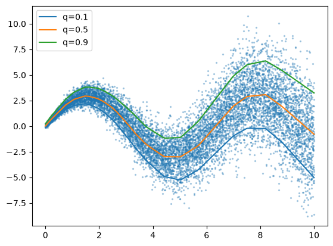

# Quantile Regression

A PyTorch neural network that learns several conditional quantiles at once with the pinball loss.

See [main.ipynb](main.ipynb) for the code and [docs/quantile_regression.pdf](docs/quantile_regression.pdf) for the full write-up.



## What is a Quantile

Let $Y$ be a random variable with CDF $F_Y(y) = P(Y \le y)$. For a level $q \in (0,1)$, the $q$-th quantile is the value below which a fraction $q$ of the probability mass lies:

$$Q_Y(q) = \inf\{\, y : F_Y(y) \ge q \,\}$$

Whereas:

- $q = 0.5$ is the **median**.
- $q = 0.1$ is the 10th percentile, and $q = 0.9$ is the 90th percentile.

Regression targets the **conditional** quantile $Q_{Y \mid X}(q \mid x)$. The pair $\big(Q(0.1 \mid x),\, Q(0.9 \mid x)\big)$ gives an 80% prediction interval at $x$.

## Loss Function: Pinball Loss

With residual $e = y - \hat y$:

$$
L_q(y, \hat y) =
\begin{cases}
q\,e & e \ge 0 \;\text{(under-prediction)} \\
(q-1)\,e & e < 0 \;\text{(over-prediction)}
\end{cases}
\;=\; \max\big(q\,e,\; (q-1)\,e\big)
$$

The penalty is asymmetric. For $q = 0.9$, under-predicting costs $0.9|e|$ but over-predicting costs only $0.1|e|$. This pushes the prediction up until about 90% of targets fall below it. For $q = 0.5$ the loss is $\tfrac12|e|$, which is minimized by the median.

```python
def pinball_loss(prediction, label, quantiles):
    error = label.view(-1, 1) - prediction          # (N, Q) via broadcasting
    return torch.max(quantiles * error, (quantiles - 1) * error).mean()
```

The model is an MLP with two hidden layers of 64 units and ReLU activations. It has one output per quantile ($q = 0.1, 0.5, 0.9$) and is trained with Adam (lr $10^{-3}$, batch size 128, 500 epochs).

## Difference from Linear Regression

|                   | Least-squares regression | Quantile regression           |
| ----------------- | ------------------------ | ----------------------------- |
| Loss              | Squared error $(y-\hat y)^2$ | Pinball loss $L_q(y,\hat y)$ |
| Estimates         | Conditional mean         | Conditional $q$-quantile      |
| Outputs per input | One value                | One value per quantile level  |
| Uncertainty       | Not captured             | Prediction intervals          |
| Outliers          | Sensitive (errors squared) | Robust (errors linear)      |
| Noise assumption  | Usually constant variance | None; handles changing spread |

"Linear" describes the model's form ($w^\top x + b$). "Least squares" and "quantile" describe the loss. This project uses a neural network, so it can learn non-linear quantile curves.

## Dataset

The data is synthetic: 10,000 samples with **heteroscedastic** noise, meaning the noise spread grows with $x$:

$$
y = 3\sin(x) + \varepsilon, \qquad
\varepsilon \sim \mathcal{N}\big(0,\,(0.1 + 0.3x)^2\big), \qquad
x \sim \mathcal{U}(0, 10)
$$

The generating process is known, so the true quantiles are known too: $Q(q \mid x) = 3\sin(x) + z_q\,(0.1 + 0.3x)$. This makes it possible to check the learned curves directly. The median should follow $3\sin(x)$, and the 0.1–0.9 band should widen as $x$ grows.
